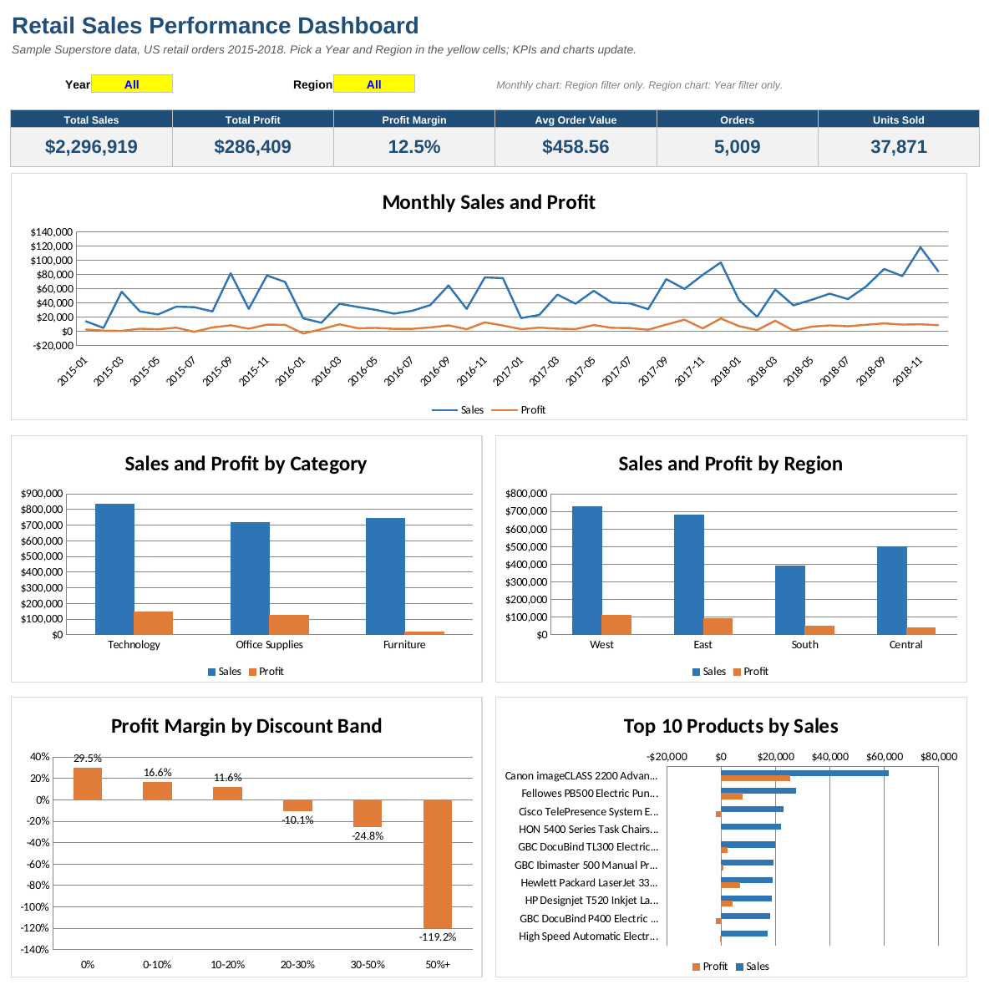
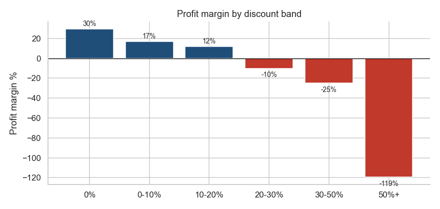

# Retail Sales Performance Analysis

An end-to-end analytics project on a public retail dataset: clean the data, validate it, analyze sales and profitability in **Excel** and **Python (pandas)**, and present the results in a dashboard. A **Power BI** report is built from the same cleaned data (see `powerbi/`).



## Business questions
1. How are sales and profit changing over time, and when do customers buy?
2. Which categories, regions and products earn money, and which do not?
3. How do discounts affect profit?
4. How much sales value is lost to returns?

## Key findings
Figures are for the full dataset (US orders, 2015-2018: $2.30M sales, $286K profit, 12.5% margin, 5,009 orders).

| # | Finding | Evidence |
|---|---|---|
| 1 | Sales and margin are growing | Sales $484K (2015) to $733K (2018); margin 10.2% to 12.7% |
| 2 | Sales are concentrated in three months | Sep, Nov and Dec bring about 43% of sales |
| 3 | Discounts above 20% lose money | Every band above 20% has a negative margin (-119% at 50%+); lines above 20% (14% of lines) lost about $135K |
| 4 | Furniture sells a lot but earns little | 32% of sales, 6% of profit; Tables, Bookcases and Supplies are loss-making |
| 5 | Central region has the weakest margin | 7.9% vs 14.9% in the West; average discount 24% vs 11% |
| 6 | Returns | About 5.9% of orders and 7.9% of sales value |

**Recommendations:** cap standard discounts at 20% with approval above that; review pricing and discount rules for Tables and Bookcases; look at discount approval in the Central region; investigate reasons for returns on high-value Technology orders.

These are associations in one sample dataset. They show where to look, not proof of cause.



## Project structure
```
data/raw/            orders.csv, returns.csv, people.csv (split from the original file)
data/processed/      orders_clean.csv (output of the notebook), python_summary_totals.csv
notebooks/           01_cleaning_and_analysis.ipynb  (cleaning, 9 validation checks, analysis, charts)
excel/               Retail_Sales_Analysis.xlsx      (formulas, dashboard, insights, reconciliation)
powerbi/             theme.json
scripts/             build and verification scripts
images/              charts and dashboard screenshots
```

## What each tool does
- **Python (pandas):** cleaning, 9 validation checks, feature engineering, analysis, charts, export of the cleaned CSV.
- **Excel:** calculated columns with formulas (YEAR, MONTH, nested IF, INDEX/MATCH), ten SUMIFS/COUNTIFS/AVERAGEIFS summary tables, a dashboard with Year and Region filters, a Checks sheet that reconciles Excel to Python.
- **Power BI:** date table and DAX measures (margin, MoM, YoY, returns), three report pages.

## Data cleaning summary
| Step | Result |
|---|---|
| Dates converted from text | all rows |
| Exact duplicate order line removed | 1 row (9,994 to 9,993) |
| Missing Postal Code filled (Burlington, VT = 05401) | 11 rows |
| Returns table de-duplicated | 800 rows to 296 unique orders |

## Reproduce
```bash
pip install -r requirements.txt
cd notebooks && jupyter nbconvert --to notebook --execute --inplace 01_cleaning_and_analysis.ipynb
```
`scripts/verify_excel.py` recomputes the Excel tables with pandas and compares them (default filters and Year 2017 / Region West).

## Data source and limits
- Data: Sample Superstore (Tableau sample dataset, publicly available; the copy used here came from a public GitHub mirror, and the dataset is also on Kaggle). It is sample data about US office supplies, furniture and technology, not a real company. Check the source's terms before reusing it.
- The Excel summary tables are formula-based. PivotTables and slicers are built separately (see `docs/excel_pivot_guide.md`).
- Python and Excel agree on all totals (see the `Checks` sheet).
